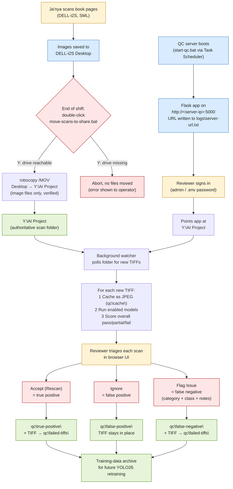
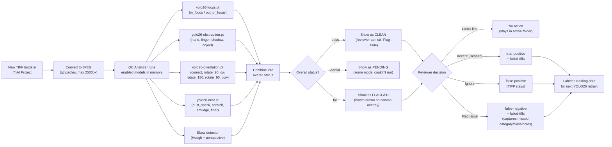

 > **NOTE (2026-07):** This document describes the original *real-time*
> workflow. The app has since moved to a **database-backed batch
> workflow**: a scheduler runs a versioned pass over the monitored
> directories once a day, a single binary mistake classifier flags
> scans, handwriting pages are transcribed via SGLang or Vertex AI,
> and reviewer verdicts are stored in SQLite (`data/qc.db`) to retrain
> new model versions. See `README.md` for the current workflow. The
> roles/machines and the move-to-share step below are still accurate.

# Yale Scanning QC — End-to-End Workflow (legacy real-time)

This document explains how a captured scan moves from the scanner
workstation all the way through the AI quality-control review and
into a structured training-data archive. No code — just the moving
parts, the people, the machines, and the decisions.

---

## TL;DR

1. **Ja'nya** captures images on the Sterling Memorial Library scanner workstation (**DELL-i2S**).
2. A double-click batch script (`move-scans-to-share.bat`) moves the new images from her Desktop to the shared **DSCA AI Project** folder on the Y drive.
3. The **Yale Scanning QC** Flask app — running at boot on a Windows host — watches the AI Project folder, auto-analyzes every new TIFF with four YOLO26 models plus a skew detector, and presents results in a browser at `http://<host-ip>:5000`.
4. The QC reviewer signs in, looks at each flagged scan, and decides: **Accept (rescan)**, **Ignore (false alarm)**, or **Flag Issue (model missed something)**.
5. Each decision writes structured metadata + a thumbnail into a `qc/` subfolder, building a labeled training set so the models keep improving.

---

## Roles & machines

| Role | Person | Machine | Operating system | What they do |
|---|---|---|---|---|
| Scanning | Ja'nya | **DELL-i2S** (Sterling Memorial Library) | Windows | Captures images, double-clicks the mover script at end of shift |
| QC review | Ja'nya | Any machine on the Yale network | Browser | Signs into the QC web app, accepts/ignores/flags scans |
| Infrastructure | William | QC server host (Windows, boots on schedule) | Windows | Runs `start-qc.bat` via Task Scheduler on startup |
| Storage | — | DSCA file share `\\…\DSCA_Digital_Studio-CC1702-LIBITS\AI Project` | — | Authoritative location for new scans and QC outputs |

---

## The full workflow, step by step

### Step 1 — Capture (DELL-i2S Desktop)

Ja'nya operates the book scanner and saves output images to her
Desktop on DELL-i2S. Images are typically high-resolution TIFFs
(but the system also accepts `.jpg`, `.jpeg`, `.png`, and common RAW
formats like `.cr2`, `.cr3`, `.nef`, `.dng`, `.arw`, `.raf`).

### Step 2 — Move scans to the shared drive

At the end of a shift (or whenever convenient), Ja'nya double-clicks
the **"Move scans to Y drive"** shortcut on her Desktop. That fires
`move-scans-to-share.bat`, which:

1. Verifies the Y drive is reachable. If not, it aborts before
   touching anything and shows a clear error.
2. Uses Windows' built-in `robocopy /MOV` to move every image file
   from her Desktop to `Y:\AI Project`. Source files are only
   deleted after the copy at the destination is verified, so a
   network blip can't lose data.
3. Skips non-image files entirely (shortcuts, Word docs, etc.).
4. Writes a timestamped log (`logs\move-YYYYMMDD_HHMMSS.log`)
   listing every file moved and any retries.
5. Pauses with a green/yellow/red summary so Ja'nya can confirm
   the move before closing the window.

After this step, no scans live on DELL-i2S anymore — they all live
on the share.

### Step 3 — The QC server picks them up

A Windows machine runs the **Yale Scanning QC** Flask app
continuously (via `start-qc.bat`, launched at boot by Task
Scheduler). It exposes the app on the LAN at
`http://<server-ip>:5000`. The access URL is written to
`logs\server-url.txt` after each boot.

When Ja'nya signs in (default credentials in `.env`:
`admin` / `Voynichisabook`) and points the app at
`Y:\AI Project`, two things happen:

- A **background directory watcher** polls the folder every few
  seconds for new or removed files.
- For every new TIFF discovered, the app:
  1. Converts the TIFF to a web-friendly JPEG (cached under
     `Y:\AI Project\qc\cache\`, max 2500px on the long edge,
     quality 85).
  2. Hands the image to the **QC Analyzer**, which runs the
     enabled models against it.
  3. Stores the per-category results and an overall
     `pass / partial / fail` status.

### Step 4 — The five QC models

Models are pre-loaded into memory once at startup so per-image
inference is fast. Each model output includes a confidence score
and, for detection models, bounding boxes.

| Category | Model file | Type | Classes / output |
|---|---|---|---|
| **focus** | `yolo26-focus.pt` | Classification | `in_focus`, `out_of_focus` |
| **obstruction** | `yolo26-obstruction.pt` | Detection (boxes) | `hand`, `finger`, `shadow`, `object` |
| **orientation** | `yolo26-orientation.pt` | Classification | `correct`, `rotate_90_cw`, `rotate_180`, `rotate_90_ccw` |
| **dust** | `yolo26-dust.pt` | Detection (boxes) | `dust_speck`, `scratch`, `smudge`, `fiber` |
| **skew** | (algorithmic — no model file) | Hough transform + perspective correction | skew angle estimate |

By default the app runs **focus** and **obstruction** on every
new scan. The reviewer can toggle the other three on/off per
session from the sidebar; toggling instantly hides/shows the
relevant check cards and bounding-box overlays.

Each scan ends up with an overall status:

- **pass / clean** — every enabled category returned `pass`
- **partial** — at least one category returned `unknown` (e.g. couldn't run)
- **fail / flagged** — at least one category returned `fail` (the model is calling foul)

### Step 5 — Reviewer triage

Ja'nya works through the file list in the sidebar. The image opens
in a viewer with:

- A **check card** per enabled model showing the result, confidence bar, and detection count
- **Bounding boxes drawn live on a canvas overlay** (not baked into the JPEG), so toggling labels, hovering categories to highlight just those boxes, and **scroll-to-zoom / drag-to-pan / double-click-to-fit** all work fluidly
- A topbar showing the file's current status (`PENDING / CLEAN / FLAGGED / IGNORED / MISSED ISSUE`)

For every scan, the reviewer can take one of three actions:

#### a) Accept (Rescan) — true positive
"Yes, the model is right, this scan is bad."
→ Writes JSON metadata + JPEG to `qc/true-positive/`
→ **Moves the original TIFF to `qc/failed-tiffs/`** so it's out of the active scan folder
→ Signals that this image needs to be re-captured

#### b) Ignore — false positive
"The model flagged this but it's actually fine."
→ Writes JSON metadata + JPEG to `qc/false-positive/`
→ **Leaves the original TIFF in place** — it's a good scan, just a noisy model

#### c) Flag Issue — false negative
"The model said this was fine but it's actually bad."
→ Reviewer opens a modal and picks:
   - **Category** the model missed (focus / obstruction / dust / orientation / skew)
   - **Specific class** (e.g. `hand`, `dust_speck`, `out_of_focus`)
   - Free-text **notes** describing what went wrong
→ Writes JSON metadata (with `missed_category`, `missed_class`, `notes`) + JPEG to `qc/false-negative/`
→ **Moves the original TIFF to `qc/failed-tiffs/`** — same as Accept, because the scan is genuinely bad

### Step 6 — Outputs become training data

After Ja'nya's shift, `Y:\AI Project\qc\` ends up structured like:

```
Y:\AI Project\
├── 0001_main_frame.tif        (untouched, passed QC)
├── 0002_main_frame.tif        (untouched, passed QC)
└── qc\
    ├── cache\                 (web-preview JPEGs, regenerable)
    ├── failed-tiffs\          (TIFFs that were Accepted or Flag-Issue'd)
    ├── true-positive\         (model said bad, reviewer agreed)
    │   ├── 0003_main_frame.json
    │   └── 0003_main_frame.jpg
    ├── false-positive\        (model said bad, reviewer disagreed)
    │   ├── 0004_main_frame.json
    │   └── 0004_main_frame.jpg
    └── false-negative\        (model said fine, reviewer flagged)
        ├── 0005_main_frame.json
        └── 0005_main_frame.jpg
```

Every JSON file records: which models ran, what each one returned
(including bounding boxes), the human decision, and (for false
negatives) what the model *should* have caught. That's the labeled
data the YOLO26 models get retrained on, closing the loop so each
iteration of the QC pipeline is more accurate than the last.

---

## End-to-end flow diagram



---

## Per-file analysis & decision detail



---

## Why this design

- **Move before analyze.** Scans land on the share *before* QC
  touches them, so the authoritative storage location and the QC
  process can scale independently and survive each other's outages.
- **Models in memory, no per-image cold-start.** All four YOLO26
  models are loaded once at server startup; per-image inference is
  fast and the reviewer never waits on model loads.
- **Bounding boxes on a canvas, not baked into JPEGs.** Server
  returns raw detection data; the browser draws the overlay. That's
  what enables live zoom/pan, label toggle, hover-to-highlight, and
  model-toggle without any re-rendering on the server.
- **Three decision categories, not two.** Accept and Ignore cover
  what the model flagged. Flag Issue covers what the model
  *should have* flagged. Without the third bucket, false negatives
  silently rot — and they're the most valuable signal for
  retraining, because they're exactly the failures the next model
  generation needs to learn.
- **Outputs are structured for retraining from day one.** Every
  reviewer click writes a JSON sidecar with the original predictions
  *and* the human verdict, so the path from "Ja'nya's QC clicks" →
  "next-generation YOLO26 weights" is a single script away.
